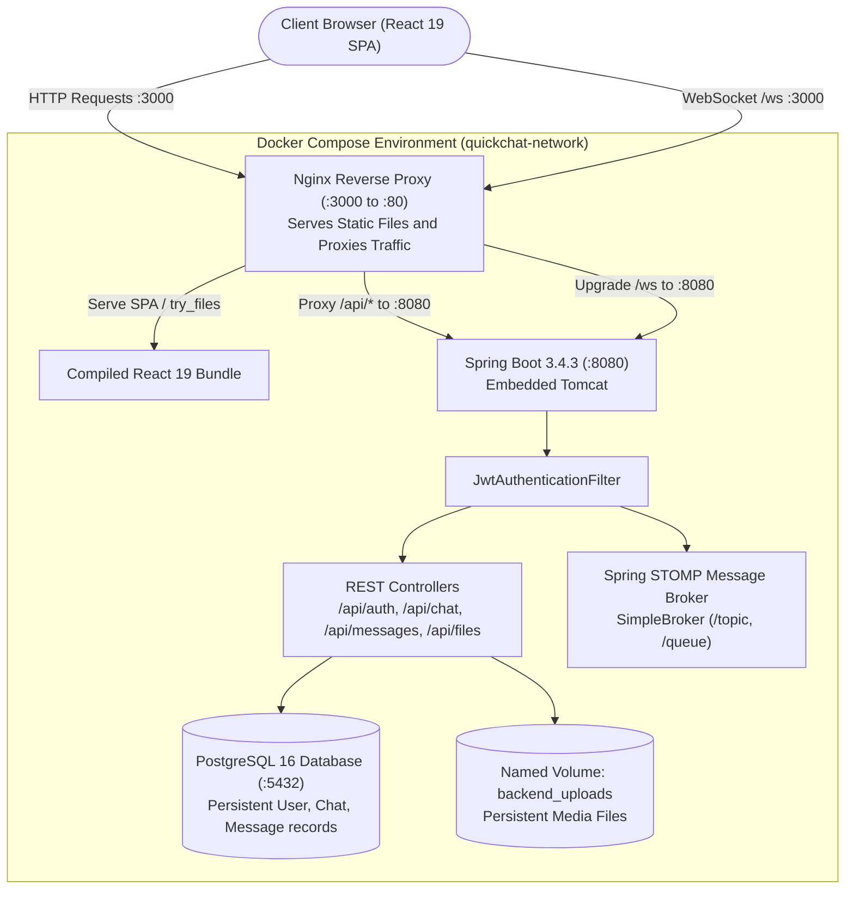
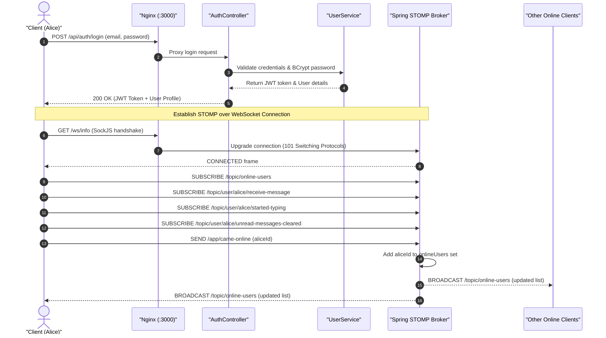
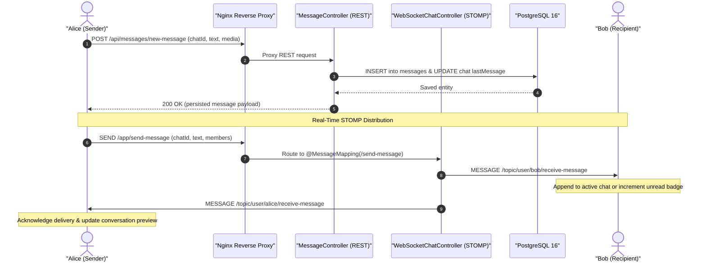
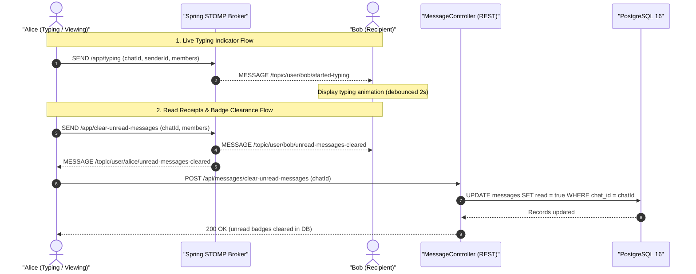
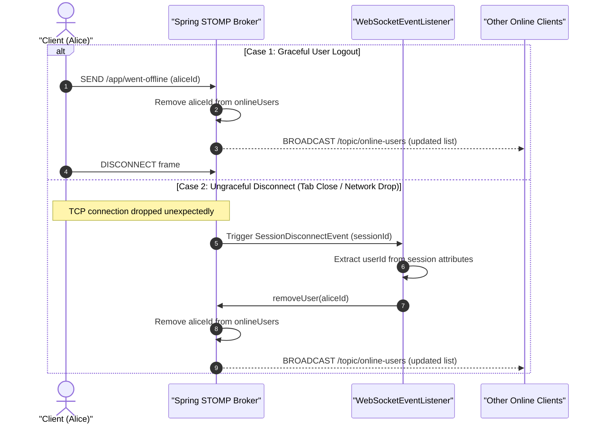
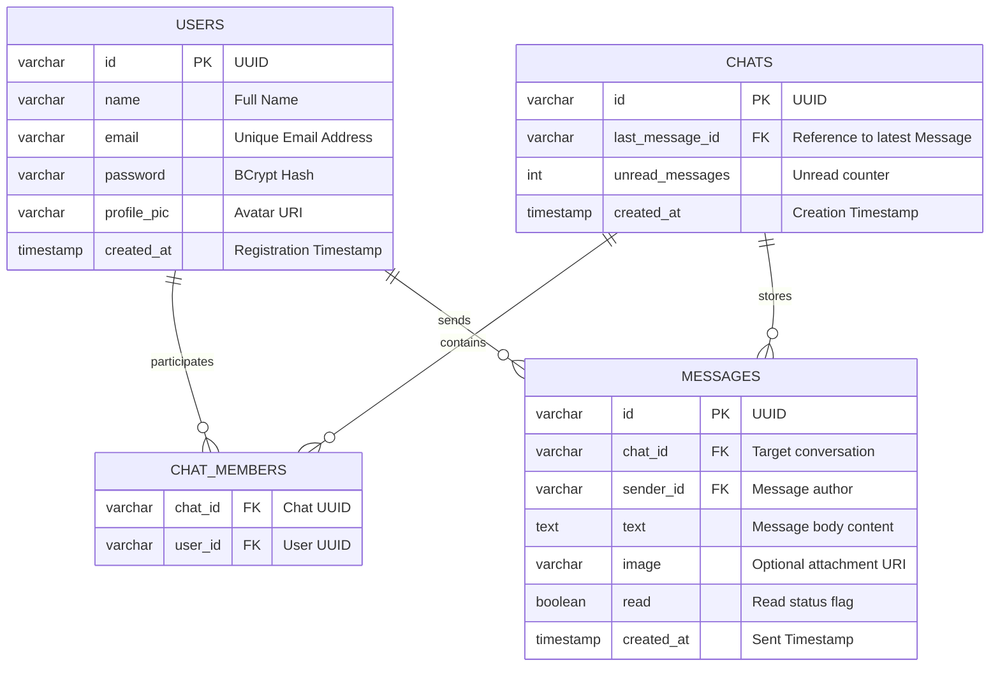

# 💬 QuickChat — Full-Stack Real-Time Messaging Platform

[](https://openjdk.org/)
[](https://spring.io/projects/spring-boot)
[](https://react.dev/)
[](https://vitejs.dev/)
[](https://www.postgresql.org/)
[](https://www.docker.com/)
[](https://nginx.org/)
[](https://tailwindcss.com/)
[](https://stomp.github.io/)

A production-grade, highly responsive, real-time messaging application engineered with **Spring Boot 3 (Java 21)**, **PostgreSQL 16**, and **React 19 (Vite)**. The platform features instantaneous message delivery using **STOMP over WebSockets (with SockJS fallbacks)**, live presence detection, typing indicators, read receipts, media uploads, stateless JWT authentication, and full multi-container orchestration via **Docker Compose** fronted by an **Nginx reverse proxy**.

---

## 📑 Table of Contents

- [Overview & Architecture](#-overview--architecture)
- [Key Features](#-key-features)
- [Tech Stack](#-tech-stack)
- [System Architecture](#-system-architecture)
- [Sequence Diagrams](#-sequence-diagrams)
  - [1. User Authentication & WebSocket Connection](#1-user-authentication--websocket-connection)
  - [2. Real-Time Message Exchange Lifecycle](#2-real-time-message-exchange-lifecycle)
  - [3. Live Typing Indicator & Read Receipts](#3-live-typing-indicator--read-receipts)
  - [4. Presence Tracking & Graceful/Ungraceful Disconnect](#4-presence-tracking--gracefulungraceful-disconnect)
- [Database Schema (ERD)](#-database-schema-erd)
- [API & WebSocket Destination Reference](#-api--websocket-destination-reference)
- [Getting Started](#-getting-started)
  - [Prerequisites](#prerequisites)
  - [Environment Configuration](#environment-configuration)
  - [Option A: Running with Docker Compose (Recommended)](#option-a-running-with-docker-compose-recommended)
  - [Option B: Running Locally (Manual Setup)](#option-b-running-locally-manual-setup)

---

## 🌟 Overview & Architecture

QuickChat is designed around a modern full-duplex client-server model:

1. **Decoupled Real-Time & Persistence Layers**: High-throughput real-time events (instant messages, typing events, presence updates) are broadcast through Spring's in-memory STOMP broker, while chat history and user credentials are systematically persisted in PostgreSQL via Spring Data JPA.
2. **Reverse Proxy Architecture**: Nginx acts as the single frontend entry point on port `3000`. It serves compiled static React assets, handles SPA client routing (`try_files`), and proxies all `/api/` HTTP calls and `/ws/` WebSocket connections to the Spring Boot backend on Docker's internal virtual bridge network, completely eliminating CORS friction in production.
3. **Optimistic & Reactive UI**: Built on React 19 and Redux Toolkit, conversation sidebars automatically reorder based on latest incoming messages, unread counters update conditionally based on the active chat viewport, and optimistic UI updates guarantee seamless user feedback.

---

## ✨ Key Features

| Feature | Description |
| :--- | :--- |
| ⚡ **Instant Messaging** | Real-time full-duplex chat delivery using STOMP protocol over WebSockets with SockJS fallback support. |
| 🟢 **Live Presence Detection** | Instant online/offline status updates broadcast across connected peers via dedicated channels, with listener-first ordering. |
| ✍️ **Typing Indicators** | Live typing feedback displayed to conversation participants when the peer starts typing. |
| 📩 **Read Receipts & Unread Badges** | Active tracking of unread messages per conversation, with dynamic badge clearance upon viewing. |
| 🖼️ **Media Attachments & Avatars** | Base64/multipart image transmission up to 50MB with inline streamable delivery through a dedicated file storage controller. |
| 🔍 **User Search & Direct Messaging** | Instant lookup of registered users with one-click conversation initialization. |
| 🔒 **Stateless JWT Security** | Spring Security 6 authorization filter, BCrypt password hashing, and Bearer token verification. |
| 🔌 **Self-Healing Disconnects** | Involuntary network dropouts and browser tab closes are caught by `SessionDisconnectEvent` to purge presence instantly. |
| 🐳 **Zero-Config Docker Deployment** | Fully automated orchestration using Docker Compose with PostgreSQL health checks and named volumes. |

---

## 🛠️ Tech Stack

### Backend
- **Language**: Java 21 (LTS)
- **Framework**: Spring Boot 3.4.3
- **Data Persistence**: Spring Data JPA / Hibernate, PostgreSQL 16
- **Real-Time Communication**: Spring WebSocket (`@EnableWebSocketMessageBroker`), STOMP, SockJS
- **Security & Tokens**: Spring Security 6, JJWT (`jjwt-api`, `jjwt-impl`, `jjwt-jackson` 0.12.6), BCrypt
- **Build & Dependency Management**: Apache Maven (wrapper included)

### Frontend
- **Library / Core**: React 19.2, React DOM
- **Build Tool**: Vite 8.3 with HMR
- **State Management**: Redux Toolkit & React Redux
- **Routing**: React Router DOM 7
- **WebSocket Client**: `@stomp/stompjs` 7.3, `sockjs-client` 1.6
- **Styling**: TailwindCSS 4, PostCSS, Autoprefixer
- **UI Components & Icons**: Remixicon, Emoji Picker React, React Toastify, Moment.js
- **Code Quality**: Oxlint

### Infrastructure & Deployment
- **Containerization**: Docker multi-stage builds (Eclipse Temurin 21 Alpine for backend, Node 20 + Nginx Alpine for frontend)
- **Reverse Proxy**: Nginx 1.25 Alpine with WebSocket upgrade handling and 50MB payload capacity
- **Database Service**: PostgreSQL 16 Alpine with native `pg_isready` healthcheck probes

---

## 📐 System Architecture



---

## 🔄 Sequence Diagrams

### 1. User Authentication & WebSocket Connection

Shows how a user logs in, receives a JWT, initialises the STOMP over WebSocket session, and announces presence.



---

### 2. Real-Time Message Exchange Lifecycle

Demonstrates how a message is simultaneously persisted in PostgreSQL and delivered to recipients in real time.



---

### 3. Live Typing Indicator & Read Receipts

Illustrates typing event broadcasting and automatic read-badge clearance when an active chat conversation is opened.



---

### 4. Presence Tracking & Graceful/Ungraceful Disconnect

Shows how presence is cleaned up reliably whether the user clicks "Logout" or closes the browser tab unexpectedly.



---

## 🗄️ Database Schema (ERD)



---

## 📡 API & WebSocket Destination Reference

### REST Endpoints

| Method | Endpoint | Description | Protected |
| :--- | :--- | :--- | :---: |
| `POST` | `/api/auth/register` | Register a new user account | No |
| `POST` | `/api/auth/login` | Authenticate and obtain JWT token | No |
| `GET` | `/api/auth/get-current-user` | Fetch profile data for the authenticated session | Yes |
| `GET` | `/api/auth/get-all-users` | Fetch list of users available to message | Yes |
| `POST` | `/api/auth/update-profile-picture` | Update avatar URL / image | Yes |
| `POST` | `/api/chat/create-new-chat` | Start a direct conversation between two users | Yes |
| `GET` | `/api/chat/get-all-chats` | Fetch all conversations involving current user | Yes |
| `POST` | `/api/messages/new-message` | Persist a new chat message | Yes |
| `GET` | `/api/messages/get-all-messages/{chatId}`| Fetch chronological message history of a chat | Yes |
| `POST` | `/api/messages/clear-unread-messages` | Mark all unread messages in a chat as read | Yes |
| `GET` | `/api/files/{fileName}` | Stream uploaded image / media file inline | No |
| `GET` | `/api/online-users` | Snapshot of active online user IDs | No |

### STOMP Broker Channels

| Direction | Destination | Payload | Description |
| :--- | :--- | :--- | :--- |
| **Inbound** (`SEND`) | `/app/came-online` | `String` (userId) | Announce client presence |
| **Inbound** (`SEND`) | `/app/went-offline` | `String` (userId) | Gracefully withdraw presence |
| **Inbound** (`SEND`) | `/app/send-message` | `SocketMessageEvent` (JSON) | Broadcast instant message to members |
| **Inbound** (`SEND`) | `/app/typing` | `SocketTypingEvent` (JSON) | Send live typing indication |
| **Inbound** (`SEND`) | `/app/clear-unread-messages`| `SocketClearUnreadEvent` (JSON)| Notify read receipt to participants |
| **Outbound** (`SUB`) | `/topic/online-users` | `List<String>` | Active user IDs array |
| **Outbound** (`SUB`) | `/topic/user/{id}/receive-message` | `SocketMessageEvent` | Private channel for incoming messages |
| **Outbound** (`SUB`) | `/topic/user/{id}/started-typing` | `SocketTypingEvent` | Private channel for typing indicators |
| **Outbound** (`SUB`) | `/topic/user/{id}/unread-messages-cleared` | `SocketClearUnreadEvent` | Private channel for read confirmations |

## 🚀 Getting Started

### Prerequisites

Ensure you have the following installed on your machine:
- **Docker** (v24.0+) & **Docker Compose** (v2.20+) — *Recommended*
- *Or for manual local running:*
  - **Java JDK 21**
  - **Node.js** (v18+ or v20+) and **npm**
  - **PostgreSQL 16**

---

### Environment Configuration

In the root of `QuickChat/`, create your `.env` file by copying `.env.example`:

```bash
cp .env.example .env
```

Populate the `.env` variables:

```ini
# PostgreSQL credentials
POSTGRES_USER=your_user
POSTGRES_PASSWORD=your_secure_password

# JWT configuration (Base64 encoded 256-bit key)
JWT_SECRET=your_secret_key
JWT_EXPIRATION=86400000
```

> **Tip:** You can generate a random 256-bit Base64 secret with:
> ```bash
> openssl rand -base64 32
> ```

---

### Option A: Running with Docker Compose (Recommended)

Start the entire stack (PostgreSQL, Spring Boot backend, Nginx frontend) with one command:

```bash
docker compose up --build
```

The services will initialize in dependency order:
1. `quickchat-postgres` launches and runs health checks via `pg_isready`.
2. `quickchat-backend` starts once PostgreSQL is healthy, runs Hibernate auto-DDL migrations, and listens on port `8080`.
3. `quickchat-frontend` builds the production React application and starts Nginx on port `3000`.

Open your browser and navigate to:
```
http://localhost:3000
```

To stop all containers:
```bash
docker compose down
```

To stop containers and reset the database volume:
```bash
docker compose down -v
```

---

### Option B: Running Locally (Manual Setup)

#### 1. Start PostgreSQL
Ensure PostgreSQL is running locally on port `5432` with a database named `quickchat`.

#### 2. Start the Backend
```bash
cd quickchat-backend

# Set environment variables (or let them fallback to default values in application.properties)
export DB_HOST=localhost
export DB_PORT=port
export DB_NAME=quickchat
export DB_USER=your_user
export DB_PASSWORD=your_secure_password
export JWT_SECRET=your_secret_key
export JWT_EXPIRATION_MS=86400000

# Run Spring Boot
./mvnw spring-boot:run
# On Windows PowerShell:
# .\mvnw.cmd spring-boot:run
```
The backend will be available at `http://localhost:8080`.

#### 3. Start the Frontend
```bash
cd quickchat-frontend

# Install dependencies
npm install

# Start Vite dev server
npm run dev
```
The frontend will start at `http://localhost:5173` (ensure `VITE_API_URL` points to `http://localhost:8080` if testing without Nginx).

---
